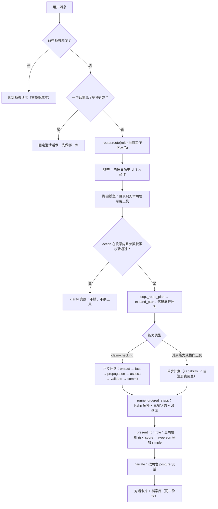
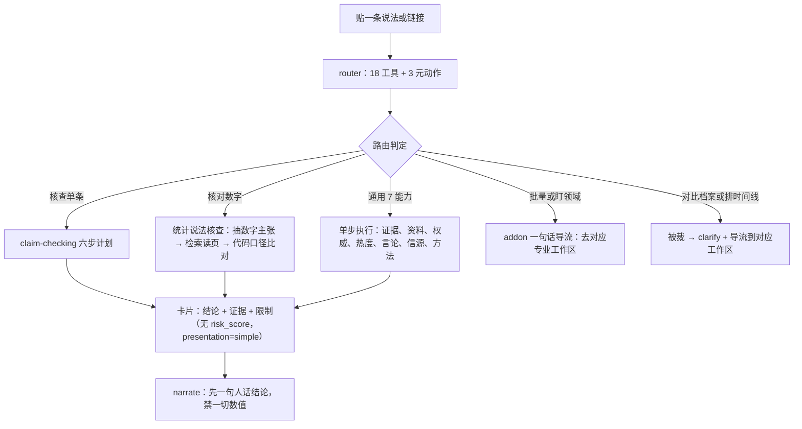
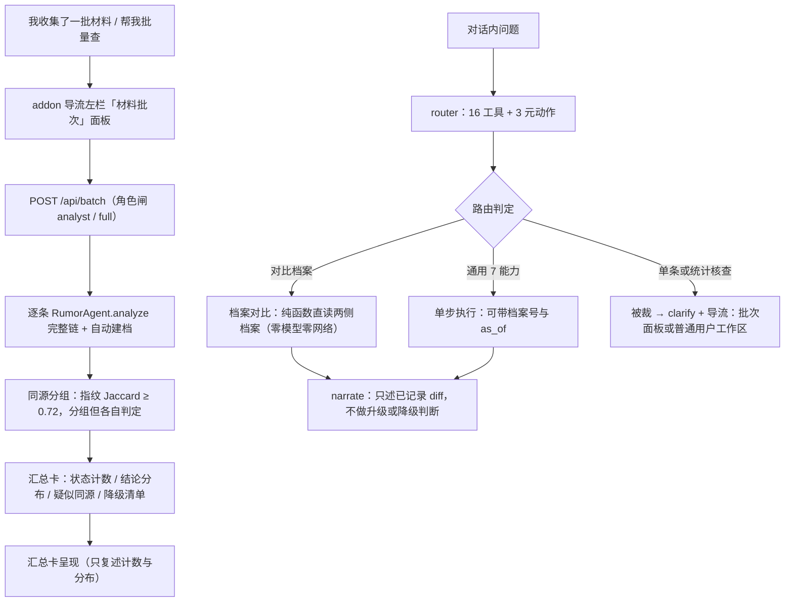
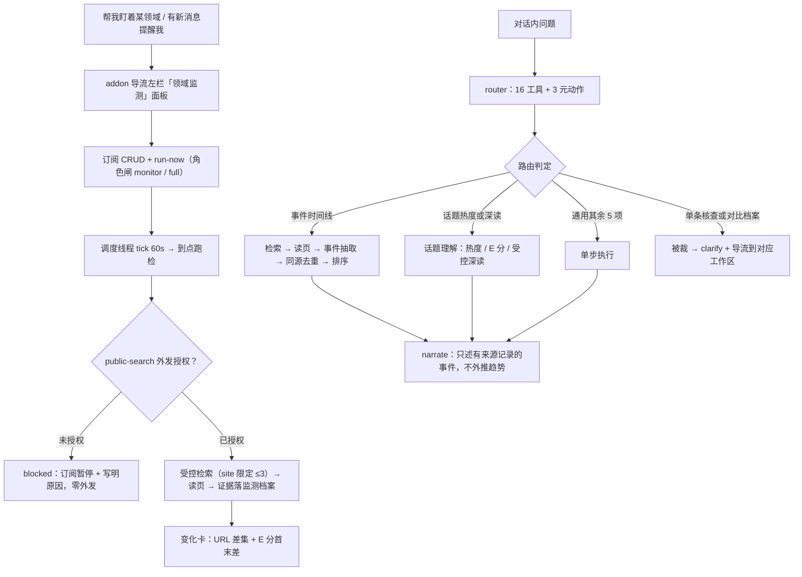
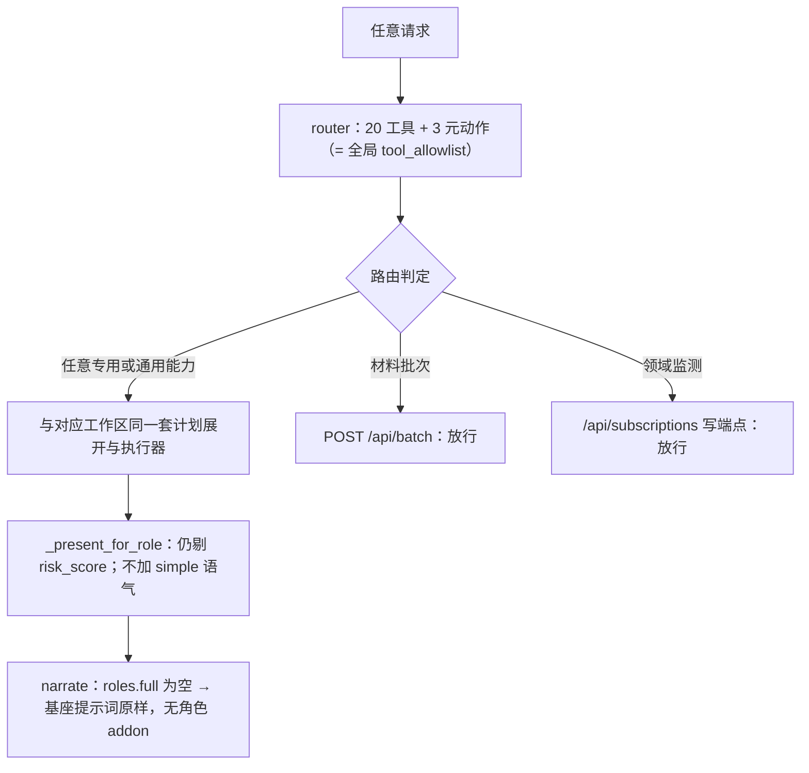
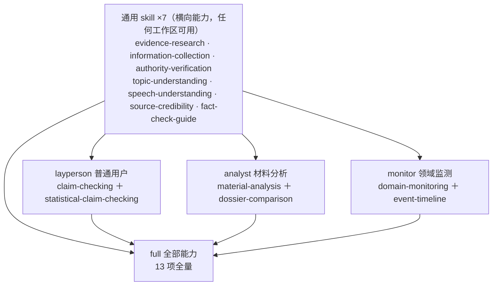

# 角色工作流与 Skill 定位总览（2026-11-23）

> 状态：**文档，不改任何行为**。本文把"四角色各自怎么走一遍"和"通用 / 专用两档 skill
> 各是什么、给谁用"画成图、列成表，供评审、交接与新会话快速对齐。
> 事实来源（发现不一致时以这些为准）：
> `src/mylocalai/assistant/workflow/registry.py`（13 项能力注册）、
> `src/mylocalai/assistant/assistant_rules.json`（`tool_allowlist` /
> `role_tool_allowlists` / `batch`）、
> `src/mylocalai/assistant/workflow/{plan,runner,claim}.py`（计划展开、拓扑执行、六步核查）、
> 各 `capabilities/*/SKILL.md` 与 `skills/*/SKILL.md` 头注释（分类元数据）。
> 人读规格：`docs/角色Agent工作流规格-v1.0.md`、`docs/Skill分类与提示词规范-v1.0.md`、
> `docs/用户角色与Profile规格-v1.0.md`、`docs/第五波专用技能-2026-11-23.md`。
> 铁律（不随角色/提示词变化）：**判定语义与角色无关**（同一说法在任何工作区同结论）、
> **模型不拼工具**（执行图由代码展开）、**每个出口都有降级**、**full 与未知角色逐位不变**。

---

## 0. 一页看懂

| 角色 | 一句话定位 | 专用主能力 | 对话工具 | 专属面板 | 主要产物 |
| --- | --- | --- | --- | --- | --- |
| `layperson` 普通用户 | 只查**一条**说法 | claim-checking、statistical-claim-checking | 18 + 3 元动作 | 无（403 + 导流） | 简化结论卡（无 risk_score） |
| `analyst` 专业用户·材料分析 | 分析**一批**自采材料 | material-analysis、dossier-comparison | 16 + 3 元动作 | 材料批次 | 批次汇总卡 + 逐条档案 |
| `monitor` 专业用户·领域监测 | 持续**盯一个领域** | domain-monitoring、event-timeline | 16 + 3 元动作 | 领域监测 | 变化卡 + 时间线卡 |
| `full` 全部能力 | 不裁剪的出口 | 13 项全量 | 20 + 3 元动作 | 两个面板都放行 | 任意能力产物 |

"3 元动作"= `chitchat` / `clarify` / `refuse`，恒在枚举内，不占工具位。
**角色只改四件事**：入口与呈现、数据范围（`profile_id` 分家）、专属面板、对话工具白名单；
不改判定打分、隐私 fail-closed 与路由防护链。

---

## 1. 通用底座：所有角色共用的一条链

图注（四个容易被忽略的点）：

1. **五道闸**：pre_refuse → mixed_choice → 白名单枚举 → 参数/权限校验 → 计划层白名单外
   action 走"枚举外 → clarify"。任何一道失败都降级，不猜。
2. **模型只出 action + 参数**；`capability_id → 步骤图`是代码映射，模型无法新增/删除必经步骤。
3. **三轴分记**：`execution_status`（running/completed/partial/failed/cancelled/
   budget_exhausted）、`task_status`（needs_clarification/no_factual_claim/not_applicable/
   not_triggered 等）、`assessment`（领域判断）。"没跑"永远不会写成"没发现"。
4. **呈现层**：`risk_score` 对所有角色都不进对话卡；`presentation="simple"` 只属 layperson；
   档案库、REST、导出仍留档数值（界面去、数据层留）。

---

## 2. 四个角色各自的工作流

### 2.1 `layperson` 普通用户（单条核查主线）

| 维度 | 口径 |
| --- | --- |
| 主责 | 单条说法核查（claim-checking）+ 统计说法核查（statistical-claim-checking） |
| 六步计划 | 提取主张 → 事实取证 → 传播记录 → 评估 → 校验 → 提交；无主张走 `no_factual_claim` 短出口，不调取证 |
| 白名单 | 18 工具，含 `verify_claim` / `recheck_dossier` / `check_statistics`；不含 `compare_dossiers` / `event_timeline` |
| 面板 | 材料批次、领域监测均 403，用一句话说明"那是专业工作区的功能，顶栏可切换" |
| 出口姿态 | 简化标题与语气、禁数值、不复述证据明细；结论基于证据，风险分不等于真假裁决 |

### 2.2 `analyst` 专业用户·材料分析（批量面板 + 通用研究）

| 维度 | 口径 |
| --- | --- |
| 主责 | 批量材料核查（material-analysis）+ 档案对比（dossier-comparison） |
| 批量预算 | 一次 ≤8 条、单条 90s、整批 900s、并发 2；单条失败不阻断，未跑记 `not_run` |
| 白名单 | 16 工具，含 `compare_dossiers`；不含 `verify_claim` / `recheck_dossier` / `check_statistics` / `event_timeline` |
| 面板闸 | `/api/batch` 仅 analyst / full；403 detail 明说"材料批次面板仅对专业用户·材料分析工作区开放" |
| 出口姿态 | 可展开证据、缺口、降级原因；汇总转述不得新增或改写条目结论 |

### 2.3 `monitor` 专业用户·领域监测（订阅调度 + 话题理解）

| 维度 | 口径 |
| --- | --- |
| 主责 | 领域监测（domain-monitoring）+ 事件时间线（event-timeline） |
| 调度口径 | 频率下限 300s；tick 60s、串行、单 worker 假设；`run-now` 202、409 防重入 |
| 白名单 | 16 工具，含 `event_timeline`；不含 `verify_claim` / `recheck_dossier` / `check_statistics` / `compare_dossiers` |
| 面板闸 | `/api/subscriptions` 写端点仅 monitor / full；读端点按 `profile_id` 归属校验 |
| 出口姿态 | 只述检索结果与变化；E 分注明"确定性公式的代理估计"；不做真假断言、不预测 |

### 2.4 `full` 全部能力（不裁剪的出口）

| 维度 | 口径 |
| --- | --- |
| 定位 | 迁移默认档 + "什么都能干"的出口，不是第五种人格 |
| 白名单 | 20 工具 + 3 元动作，与全局 `tool_allowlist` 同集；`role="full"` 恒全量、不读配置 |
| 面板 | 同时在 {analyst, full} 与 {monitor, full} 内，两个闸都放行 |
| 提示词 | `roles.full = {}`，router / narrate 基座逐位不变 |

---

## 3. 两档 skill 的分界（先看这张图）

**定义**（《Skill分类与提示词规范-v1.0》§2，按角色绑定）：

- **通用 skill**：横向能力，不绑定特定角色，任何工作区（含 full）都可用；
  它回答"查证过程中的某一类通用问题"，**不定义某个工作区的产物形态**。
- **专用 skill**：绑定特定角色的主能力，是该角色工作区的**核心产物形态**；
  除 full 外只对绑定的那一个角色开放。

一句话记忆：**通用 = 大家都能用的"工具"；专用 = 这个工作区"交什么货"。**

---

## 4. 通用 skill（7 项）：功能、定位、对应角色

| 能力（capability id） | 入口工具 | 功能（做什么） | 定位（与谁互补） | 出口边界 |
| --- | --- | --- | --- | --- |
| `evidence-research` 证据研究 | `collect_evidence` | 领域识别 → 信源发现 → 逐主张检索读页 → 可定位引文与缺口 | "只要证据、不下结论"的取证底座；claim-checking 的事实取证复用它 | 不判真假、不建档、不给分 |
| `information-collection` 资料收集 | `collect_research` | 定范围 → 多轮检索 → 读页摘录 → 研究简报 | 面向"调研一个主题"；与证据研究的"针对一条主张取证"分工 | 不判真假、不建档；未核验来源只作线索 |
| `authority-verification` 权威核验 | `verify_authority` | 拆主张 → 权威源发现 → 阅读取证 → 受约束分析（balance/lean 由代码算） | 面向"有没有官方依据"；与信源速查的"单源画像"互补 | 无决定性证据不说"证明/反驳"；无分数、无固定真假标签 |
| `topic-understanding` 话题理解 | `check_heat` / `compute_heat` / `deep_read` | 检索估参 → 确定性公式算关注度 → 可选受控深读 | 回答"有多热、为什么受关注"；是 domain-monitoring 的能力底座 | 热度≠真实性；E 分是代理估计；深读不回写分数 |
| `speech-understanding` 言论理解 | `analyze_speech` | classic 三维：情绪 / 攻击性 / 逻辑 | 分析"怎么说"，与"说的是不是事实"分开 | 表达风格不得当事实证据；强度档位化呈现 |
| `source-credibility` 信源可信度速查 | `check_source` | 安全取页 1 页 → 权威信号（官方后缀 / 正文官方标记 / 已核验直链 / 交叉提及 ≥2）→ 画像摘要 | 单源身份速查；与权威核验的"多源对主张"互补 | 只评信源身份不判内容；无战绩如实说；不建档、无分数 |
| `fact-check-guide` 辟谣方法指南 | `guide_fact_check` | 代码锁定的"查证五步法"+ 受约束讲解 | 教方法；与替他查的 claim-checking 互补 | 零检索零取页；讲解含 URL 或判定词整条丢弃、退模板 |

**对应角色**：以上 7 项 `roles = _ALL_ROLES`，**四个工作区全部可用**，且都进各自的白名单。
它们仍受隐私授权（`fail-closed`）、预算与超时约束——**分类只决定"给谁用"，不决定"能不能外发"**。

---

## 5. 专用 skill（6 项）：功能、定位、对应角色

| 能力（capability id） | 绑定角色（+ full） | 通道 / 入口 | 功能（做什么） | 产物形态 | 角色边界与出口约束 |
| --- | --- | --- | --- | --- | --- |
| `claim-checking` 事实核查 | layperson | 对话 `verify_claim` / `recheck_dossier`；六步计划 | 一条说法的完整核查：主张 → 事实证据 → 传播 → 评估 → 校验 → 提交 | 结论卡（结论 + 证据 + 限制） | 结论必须受证据与限制约束；不把 `risk_score` 当真假判定；无主张走诚实短出口 |
| `statistical-claim-checking` 统计说法核查 | layperson | 对话 `check_statistics`；单步计划 | 抽数字主张 → 逐条检索读页 → 代码口径比对（千分位/精度/单位归一） | 四态卡：一致 / 不一致 / 口径不一致 / 未核实到 | 只比数字不判内容；「未核实到」绝不写成「数字为假」；不建档 |
| `material-analysis` 材料分析 | analyst | 面板 + `POST /api/batch`（不占对话枚举） | 逐条核查自采材料 + 自动建档 + 跨条汇总 | 批次汇总卡 + 逐条档案 | 汇总只复述计数与分布；单条失败不阻断；`not_run` 不写成"没发现" |
| `dossier-comparison` 档案对比 | analyst | 对话 `compare_dossiers`；单步纯函数 | 两份已建档案的结论标签演进、as_of/置信度档位、证据与域名差集、指纹相似度 | 对比卡（diff 列表） | 只述已记录 diff；「疑似同源」不是同一性证明；零模型零网络、不写库 |
| `domain-monitoring` 领域监测 | monitor | 面板 + REST + 调度线程（不占对话枚举） | 订阅话题后定时跑检，每轮给变化摘要 | 变化卡（URL 差集 + E 分首末差） | 只述检索结果与变化；不做真假断言；未授权 → `blocked`、零外发 |
| `event-timeline` 事件时间线 | monitor | 对话 `event_timeline`；单步计划 | 检索 → 读页 → 事件抽取 → 同源转载去重 → 按时间排序 | 时间线卡（每条带逐字引文 + 来源 URL） | 只述有来源记录的事件；无日期事件单列 `undated` 区；不外推趋势；不建档 |

**"专用"的确切含义**（三个要点）：

1. **它是角色主责，不是权限等级**。专用 ≠ 更高级、更可信；通用能力在专用工作流里同样被调用
   （例如 analyst 的批量核查内部走 RumorAgent 完整链，monitor 用 topic-understanding 算热度）。
2. **它决定白名单裁剪**：`verify_claim`/`recheck_dossier`/`check_statistics` 仅
   layperson+full；`compare_dossiers` 仅 analyst+full；`event_timeline` 仅 monitor+full。
   被裁工具在路由模型目录里直接不出现；模型若仍产出 → 走"枚举外 → clarify"。
3. **它不改变判定语义**：同一说法在 layperson 与 full 得到同一结论；差别只在入口、呈现与产物。

---

## 6. 执行层 12 份 SKILL.md 如何服务能力层

能力层回答"给谁用"，执行层回答"这一步怎么做"。两者用 SKILL.md 头注释的
`分类` / `适用角色`（能力层）与 `分类` / `服务能力`（执行层）建立映射，测试逐字对拍。

| 执行层 SKILL.md | 分类 | 服务能力 |
| --- | --- | --- |
| `skills/domain` 领域识别 | 通用 | `evidence-research` |
| `skills/sources` 信源发现 | 通用 | `evidence-research` |
| `skills/evidence` 证据检索 | 通用 | `evidence-research` |
| `skills/research/scope` 范围与子问题 | 通用 | `information-collection` |
| `skills/research/digest` 阅读摘录与综述 | 通用 | `information-collection` |
| `skills/authority/authority` 权威源发现与身份核验 | 通用 | `authority-verification` |
| `skills/authority/adjudicate` 受约束分析 | 通用 | `authority-verification` |
| `skills/source` 信源画像 | 通用 | `source-credibility` |
| `skills/guide` 查证五步法 | 通用 | `fact-check-guide` |
| `skills/statistics` 统计口径比对 | 专用 | `statistical-claim-checking` |
| `skills/comparison` 档案对比 | 专用 | `dossier-comparison` |
| `skills/timeline` 事件时间线 | 专用 | `event-timeline` |

补充：`RumorAgent` 引擎的 `SYSTEM_PROMPT` 服务 `claim-checking`（专用），它不在这 12 份
SKILL.md 之列；`topic-understanding` 与 `speech-understanding` 由既有模块（attention /
classic 链）承载，也不单独占执行层 SKILL.md。

---

## 7. 能力 × 角色 裁剪矩阵

| 能力 | 分类 | layperson | analyst | monitor | full |
| --- | --- | :---: | :---: | :---: | :---: |
| evidence-research | 通用 | ✓ | ✓ | ✓ | ✓ |
| information-collection | 通用 | ✓ | ✓ | ✓ | ✓ |
| authority-verification | 通用 | ✓ | ✓ | ✓ | ✓ |
| topic-understanding | 通用 | ✓ | ✓ | ✓ | ✓ |
| speech-understanding | 通用 | ✓ | ✓ | ✓ | ✓ |
| source-credibility | 通用 | ✓ | ✓ | ✓ | ✓ |
| fact-check-guide | 通用 | ✓ | ✓ | ✓ | ✓ |
| claim-checking | 专用 | ✓ | — | — | ✓ |
| statistical-claim-checking | 专用 | ✓ | — | — | ✓ |
| material-analysis（面板） | 专用 | — | ✓ | — | ✓ |
| dossier-comparison | 专用 | — | ✓ | — | ✓ |
| domain-monitoring（面板） | 专用 | — | — | ✓ | ✓ |
| event-timeline | 专用 | — | — | ✓ | ✓ |

- **analyst 与 monitor 自第五波起不再同集**：analyst − monitor = {`compare_dossiers`}，
  monitor − analyst = {`event_timeline`}（`tests/test_role_allowlists.py` 锁定）。
- **fail-open**：配置段缺失 / 角色缺项 / 非列表 / 空列表 → 回落全局 `tool_allowlist`；
  `full` 恒全量。缺配置时行为与加角色前逐位一致。
- **横向工具 6 个不参与裁剪、也不算 skill**：`list_dossiers` / `get_dossier` /
  `export_card` / `search_web` / `insights` / `read_opinions`——它们是对话跟进机制，
  `capability_for_action` 对它们返回 `None`，计划层按单步直执。

---

## 8. 新增一项能力时，先回答这三个问题

1. **它是不是某个角色的主责产物？**
   - 是 → **专用**：绑定该角色（`roles=("<角色>", "full")`），进该角色白名单，写清角色边界；
   - 否 → **通用**：`roles=("layperson","analyst","monitor","full")`，四个工作区都进白名单。
2. **它走哪条通道？** 对话工具（占 `entry_actions`）/ 面板 + REST（`channel="面板"`，
   `composite=True`，不占对话枚举）。面板必须补服务端角色闸。
3. **它的出口姿态是什么？** 能不能下真假结论、给不给分、建不建档、失败怎么降级——
   写进能力层 `SKILL.md`，执行细节写进执行层 `SKILL.md`，机器契约只登记在注册表。

登记顺序（漏登记会直接测试失败）：`workflow/registry.py` 的 `CAPABILITIES` →
`assistant_rules.json` 的白名单 → 能力/执行层 `SKILL.md` 头注释 →
`tests/test_role_prompts.py` 的 `EXPECTED_CAPS` / `EXPECTED_CLASSIFICATION` /
`EXPECTED_SKILL_SERVICE`。

---

## 9. 与既有文档的关系（避免双维护）

| 想知道什么 | 看哪里 |
| --- | --- |
| 四角色流程与编排引擎的实施细节、测试矩阵 | `docs/角色Agent工作流规格-v1.0.md` |
| 通用/专用分类的定义与提示词规范 | `docs/Skill分类与提示词规范-v1.0.md` |
| 角色、Profile、数据分家与面板契约 | `docs/用户角色与Profile规格-v1.0.md` |
| 第五波三条专用技能的实施口径 | `docs/第五波专用技能-2026-11-23.md` |
| 用户能力总表与 Plan/Run 基线 | `docs/Agent工作流规格-v0.1.md` |
| 机器契约 | `workflow/registry.py`、`assistant_rules.json`、各 SKILL.md 头注释 |

本文只做"图 + 定位"的人读汇总，不复制可执行细节；与代码不一致时以机器契约为准，
并回头修正本文。
